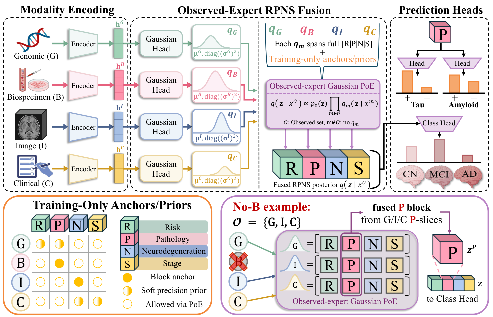

<div align="center">

# CoPoE

### Multimodal Fusion via Decomposable Disease-Coordinate<br>Product-of-Experts for Missing-Modality Alzheimer's Diagnosis

**Chihun An · Ikbeom Jang**  
Hanyang University · Hankuk University of Foreign Studies

[](#quick-start)
[](#quick-start)
[](LICENSE)

[Overview](#overview) · [Quick start](#quick-start) · [Results](#results) · [Documentation](#documentation) · [Citation](#citation)

</div>

<p align="center">
  
</p>

<p align="center"><em>Four modality groups. A shared disease-oriented latent space. Fusion over the evidence that is observed.</em></p>

## Overview

CoPoE combines **genomic, biospecimen, imaging, and clinical** evidence for CN/MCI/AD classification when modalities are missing. Each observed modality contributes a diagonal Gaussian expert over four disease-motivated blocks: **Risk, Pathology, Neurodegeneration, and Stage (R/P/N/S)**.

- **Observed-expert fusion.** A masked Gaussian Product-of-Experts combines available modalities; absent modalities contribute no factor in the RPNS fusion path.
- **Structured representation.** The 48-dimensional latent uses an **8 / 16 / 16 / 8** partition. PET-derived labels provide auxiliary supervision for the pathology block; PET is not a fusion input.
- **All 15 modality subsets.** A common complete-case evaluation panel supports controlled comparisons as inputs are withheld.

Classification also uses a residual branch over zero-filled frozen embeddings. RPNS names describe intended roles; PET probing measures supervised pathology enrichment, not independent biological validation of all four blocks.

## Quick start

Use Python 3.10 or newer. Create an environment, install a [PyTorch build](https://pytorch.org/get-started/locally/) appropriate for your CPU or CUDA environment, then install CoPoE:

```bash
git clone https://github.com/labhai/CoPoE.git
cd CoPoE
python -m venv .venv
source .venv/bin/activate
python -m pip install --upgrade pip
python -m pip install -e .
```

If PyTorch is not already installed in the environment, `pip` installs it as a dependency. For a specific CUDA build, install PyTorch before the final command. If you downloaded a ZIP, extract it and start with `cd CoPoE`. On Windows, activate the environment with `.venv\Scripts\Activate.ps1` in PowerShell.

**Try the full pipeline with synthetic data — no ADNI download or GPU required:**

```bash
python -m copoe.demo --out runs/demo
```

The demo generates synthetic embeddings, prepares the splits, trains one seed on CPU for two epochs, and evaluates all 15 non-empty subsets. Results are written to `runs/demo/model/standalone_eval.csv`. Use a new output directory for each demo run.

Synthetic metrics verify software execution; they are not the paper's ADNI results.

## Results

**Reported in the manuscript:** five-seed performance on the shared non-PET ADNI embedding benchmark. These values are transcribed from the paper, not recomputed by the synthetic demo.

| Setting | BAcc ↑ | Macro-F1 ↑ | AUROC ↑ | ECE ↓ | Brier ↓ | NLL ↓ |
|:--|--:|--:|--:|--:|--:|--:|
| All four modalities | **71.87 ± 0.89** | **71.92 ± 0.62** | **85.80 ± 0.33** | **0.086 ± 0.011** | **0.408 ± 0.003** | **0.681 ± 0.006** |

BAcc, macro-F1, and AUROC are percentages. Mean AUROC over the 15 subsets is **77.82%**, with the highest AUROC among the compared baselines in **12 of 15** settings.

> **Reproduction status.** The release includes encoder architectures, training/export commands, fusion training, and subset evaluation. Original ADNI data, participant splits, frozen embeddings, and pretrained weights are not included. The current checkpoint-selection rule and KL implementation also differ from the manuscript wording; see [reproducibility notes](docs/reproducibility.md) before attempting to reproduce the reported numbers.

## Train and evaluate

Prepare authorized, frozen 128-dimensional embeddings for each modality using the [data guide](docs/data.md), then run:

```bash
python -m copoe.prepare \
  --embeddings-dir /path/to/frozen_embeddings \
  --pet-labels /path/to/pet_labels.csv \
  --out data

python -m copoe.train \
  --train data/train.npz \
  --val data/val_all4.npz \
  --test data/test_all4.npz \
  --out runs/main \
  --seeds 42 43 44 45 46

python -m copoe.evaluate \
  --checkpoint runs/main/seed42/best.pt \
  --data data/test_all4.npz \
  --output runs/main/seed42/test_subsets.csv
```

The default training configuration expects both positive and negative amyloid and tau labels in training and validation. The [training guide](docs/training.md) covers encoder pretraining, GPU execution, and the diagnosis-only variant.

## Documentation

| Guide | Contents |
|:--|:--|
| [Data preparation](docs/data.md) | Input arrays, modality order, train-only normalization, PET labels, and participant-disjoint splits |
| [Training and evaluation](docs/training.md) | Four encoder architectures, embedding export, fusion training, and checkpoint evaluation |
| [Reproducibility](docs/reproducibility.md) | Actual training settings, manuscript differences, and the scope of this release |
| [Publishing guide](docs/publishing.md) | Upload layout, repository settings, and landing-page checks |

### Repository structure

| Path | Purpose |
|:--|:--|
| [`assets/`](assets/) | Architecture figure from the manuscript |
| [`copoe/`](copoe/) | Python package and command-line modules |
| [`copoe/model.py`](copoe/model.py), [`biology.py`](copoe/biology.py) | Gaussian experts, masked PoE, residual classification, losses, and PET heads |
| [`copoe/encoders.py`](copoe/encoders.py), [`pretrain.py`](copoe/pretrain.py), [`encode.py`](copoe/encode.py) | Modality encoders, training, and frozen embedding export |
| [`copoe/prepare.py`](copoe/prepare.py), [`data.py`](copoe/data.py) | Split assembly, validation, and data loading |
| [`copoe/config.py`](copoe/config.py), [`train.py`](copoe/train.py), [`evaluate.py`](copoe/evaluate.py) | Configuration, fusion training, and subset evaluation |
| [`docs/`](docs/) | Detailed usage and reproduction notes |
| [`tests/`](tests/) | Synthetic regression and pipeline tests |
| [`.github/workflows/ci.yml`](.github/workflows/ci.yml) | Automated CPU tests |

Run the test suite locally:

```bash
python -m unittest discover -s tests -v
```

## Data access and license

Obtain ADNI data through the [official ADNI portal](https://adni.loni.usc.edu/) under its access terms. This repository distributes source code under the [MIT License](LICENSE); that license does not grant rights to ADNI data or third-party assets. Participant-level data and checkpoints containing participant identifiers are not part of this release.

## Citation

```bibtex
@misc{an2026copoe,
  title  = {{CoPoE}: Multimodal Fusion via Decomposable Disease-Coordinate
            Product-of-Experts for Missing-Modality Alzheimer's Diagnosis},
  author = {An, Chihun and Jang, Ikbeom},
  year   = {2026},
  url    = {https://github.com/labhai/CoPoE}
}
```

## Contact

For implementation questions, open a [GitHub issue](https://github.com/labhai/CoPoE/issues). For research inquiries: [Chihun An](mailto:chihun@hanyang.ac.kr) or [Ikbeom Jang](mailto:ijang@hufs.ac.kr).
